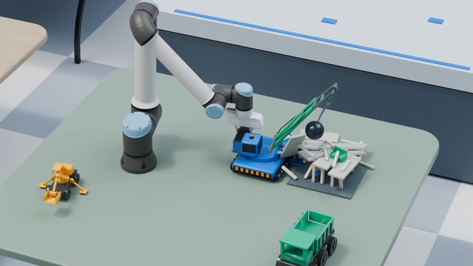

# steelX — offline, vendored Steel physics engine

> **Development status (2026-11-09):** The repository currently contains upstream
> Steel launch documentation and media. A complete offline engine has **not** yet
> been imported, built, or verified. The roadmap, vendor verification tools,
> and a network-free WebGPU scene decoder are early implementation steps.

steelX's target is a **fully vendored, properly licensed, offline-capable physics
engine** encompassing Newton's Steel solver, Warp dependencies, and the WebGPU
implementation. The engine's build, execution and simulation must not require a
cloud solver, package registry, hosted asset, or online license check. The
default TextPCB integration runs privately on TextPCB-controlled workers;
an offline-capable engine does **not** imply distribution of private TextPCB
source, worker images or credentials to customers.

- [Engineering roadmap](ROADMAP.md) — code audit → standalone vendored engine → product integration.
- [Offline and licensing contract](docs/OFFLINE_CONTRACT.md) — supported targets,
  dependency closure, redistribution rules, and strict release evidence.
- [Source-level audit findings](docs/AUDIT_BASELINE.md) — observed network loaders,
  CPU/GPU limitations, and the next code changes required.
- [Pinned-source API, dependency and license audit](docs/SOURCE_AUDIT_2026-11-09.md)
  — exact-code evidence, supported-mode caveats and remaining release gates.
- [Pinned upstream sources](vendor/upstreams.lock.json) — exact revisions.
- [Source importer](tools/vendor_sources.py) and [validator](tools/verify_vendor.py)
  — maintenance groundwork; they do **not** establish an offline release.
- [Offline WebGPU scene decoder](src/offline-scene.mjs) — integrity-checks already
  supplied scene and mesh bytes without fetching them; the complete WebGPU
  simulation engine and viewer are **not** yet integrated.

## Implemented, independently testable offline component

`loadOfflineScene` accepts raw `scene.json` and `scene.bin` bytes, a map of
preloaded meshes, SHA-256 hashes for exactly those files, and an optional
`sceneDir` inside a logical asset root. It returns the scene shape accepted
by the pinned WebGPU `Sim` constructor. Upstream scene references such as
`../shared/meshes/model.bin` work when they remain inside that root; remote
URLs and paths escaping the root fail closed. It never calls `fetch`.

```js
import { loadOfflineScene } from './src/offline-scene.mjs';

const scene = await loadOfflineScene({
  json: sceneJsonBytes,
  bin: sceneBinBytes,
  sceneDir: 'bolt_sweep',
  meshes: new Map([['shared/meshes/example.bin', localMeshBytes]]),
  integrity: new Map([
    ['bolt_sweep/scene.json', expectedJsonSha256],
    ['bolt_sweep/scene.bin', expectedBinSha256],
    ['shared/meshes/example.bin', expectedMeshSha256],
  ]),
});
// After the pinned upstream source is imported, pass scene to Sim.create(device, scene).
```

The illustrative keys must match the actual mesh references in the supplied
scene JSON; supplying bytes is the caller's responsibility. To run the
dependency-free decoder tests: `node --test tests/offline-scene.test.mjs`.
This validates a data path, **not** GPU physics, browser support, or overall
offline-ready status.

## Original Steel launch information

[](https://github.com/user-attachments/assets/be138f43-7852-40dc-a7ab-de1b2aa49cde)


Steel is Skild's physics solver for scalable simulation of manipulation, built with NVIDIA and open-sourced as part of Newton. Across 20 robot-learning benchmarks it delivers 3.8× PhysX's simulation throughput (geometric mean), and up to 13× on heterogeneous batches that mix different robots and tasks, while using less GPU memory.

We are actively accepting contributions from you and your agents, and are committed to maintaining Steel as a shared foundation for diverse, scalable simulation.

## Updates

- **November 9, 2026** — The open-source launch of Steel.

## Code and demos

- [Steel in Newton](https://github.com/newton-physics/newton/tree/main/newton/_src/solvers/steel) — the solver implementation.
- [WebGPU implementation](https://github.com/skild-ai/steel-webgpu) — the browser implementation.
- [Playground](https://www.skild.ai/steel/playground) — interactive demos.
- [Blog](https://www.skild.ai/steel) — the launch write-up.

## License

Steel is licensed under the [Apache License, Version 2.0](LICENSE). The solver is distributed as part of [Newton](https://github.com/newton-physics/newton), which is also licensed under Apache-2.0.

Third-party assets and media retain their own licenses.
